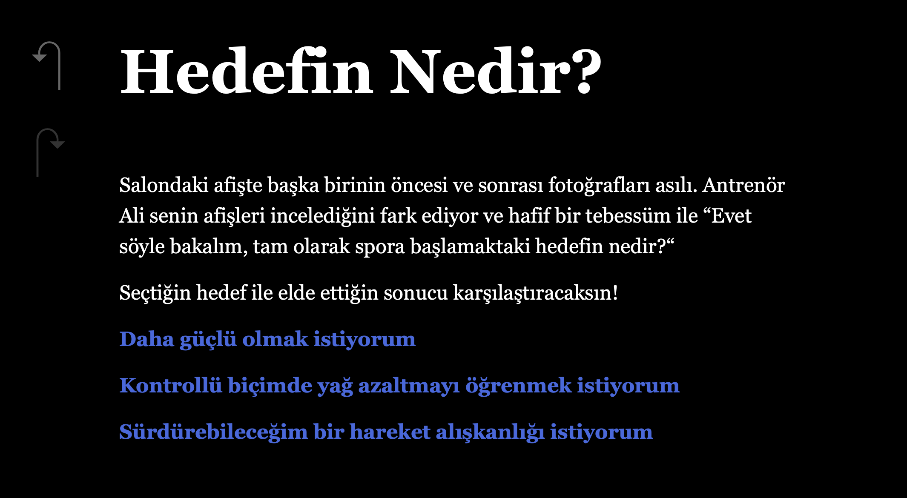

# Kendi Ritmin - Altı Haftalık Bir Başlangıç

## 1. Présentation et fonctionnalités

**Kendi Ritmin** est une fiction interactive en turc consacrée à six semaines d’entraînement, d’alimentation et de récupération. Le jeu a été réalisé avec Twine et le format Harlowe.

Le joueur choisit un objectif, puis prend des décisions concernant l’intensité de l’entraînement, l’alimentation, le sommeil et le repos. Ces choix modifient des indicateurs qui s’accumulent au fil du parcours et interviennent dans les résultats hebdomadaires et la fin du jeu.

- 60 passages et six fins possibles.
- Choix d’un objectif et suivi des valeurs de développement musculaire, de variation de graisse, de fatigue, de risque et de connaissances.
- Événements propres à chaque semaine et gestion d’une décision de pause.
- Possibilité de recommencer à la fin du parcours.

Les valeurs sont des indicateurs fictionnels propres au jeu : elles ne prédisent pas des changements physiques réels.

## 2. Capture du jeu

## 3. Installation et lancement

### Jouer sur son ordinateur

1. Télécharger le dépôt avec **Code > Download ZIP**.
2. Décompresser l’archive.
3. Ouvrir **index.html** dans un navigateur web.

Aucune installation de logiciel ou de paquet supplémentaire n’est nécessaire pour jouer. Les liens vers les sources documentaires nécessitent une connexion Internet.

### Examiner les passages et les codes

Dans [Twine](https://twinery.org/2/), utiliser **Library > Import**, puis sélectionner le fichier **index.html**. L’importation permet d’ouvrir la carte des passages et d’examiner leur contenu dans l’éditeur.

## 4. Technologies et composants intégrés

- **Twine 2.12.1**, version indiquée dans le fichier exporté.
- **Harlowe 3.3.9**, moteur de récit intégré dans le fichier HTML.
- Macros Harlowe pour les variables, les choix, les conditions, les calculs et les déplacements entre passages.
- Balises HTML pour les liens documentaires et les indicateurs affichés dans le jeu.

Le fichier **index.html** contient le récit, les passages et le moteur nécessaire à son exécution. Aucun serveur, base de données ou téléchargement de bibliothèque complémentaire n’est requis. Les espaces de JavaScript et de CSS personnalisés sont vides dans cette version.

## 5. Sources, ressources et crédits

Le scénario et les textes narratifs sont d’Alican Yılmazer. Les mentions de licence et les crédits des composants intégrés par Twine/Harlowe sont conservés dans le fichier exporté. Aucune licence supplémentaire n’a été ajoutée au dépôt pour les textes du projet.

### Outils et documentation

- [Twine](https://twinery.org/) et [documentation de l’éditeur](https://twinery.org/reference/en/).
- [Manuel et liste des macros Harlowe](https://twine2.neocities.org/).
- Vidéos YouTube consultées pour apprendre à utiliser Twine et Harlowe ; la liste précise des vidéos n’est pas consignée ici.
- Guide de macros avec explications en turc préparé avec l’aide d’un LLM ; ce document accompagne séparément la remise à l’enseignant.

### Références présentes dans le passage « Sources »

- [CDC - Physical Activity Guidelines for Adults](https://www.cdc.gov/physical-activity-basics/guidelines/adults.html).
- [NIDDK - Health Tips for Adults](https://www.niddk.nih.gov/health-information/weight-management/healthy-eating-physical-activity-for-life/health-tips-for-adults).
- [NIH - Insomnia](https://health.nih.gov/health-topics-a-z/insomnia).
- [NIAMS - Sports Injuries](https://www.niams.nih.gov/health-topics/sports-injuries).
- [NIAMS - Sports Injuries: Diagnosis, Treatment, and Steps to Take](https://www.niams.nih.gov/health-topics/sports-injuries/diagnosis-treatment-and-steps-to-take).

## 6. Recours aux LLM

### Outils déclarés

- **ChatGPT**, version indiquée par l’auteur : **6.0**.
- **Euria**, version précise non renseignée.

### Principaux usages décrits pour ce projet

- Préparer une liste de macros et de codes adaptés aux fonctionnalités envisagées, avec leurs explications en turc, pour constituer un guide de référence.
- Apprendre à utiliser Twine, comprendre les macros Harlowe et leur application.
- Comprendre la création des liens HTML, notamment la balise `<a>` et l’attribut `href`.
- Regrouper les indicateurs du jeu dans une structure `
`.
- Obtenir un appui mathématique pour les résultats hebdomadaires et les conditions de fin, en utilisant l’IA comme une calculatrice.
- Obtenir de l’aide pour intégrer le système de pause dans le déroulement du jeu.
- Comprendre et utiliser les accolades `{ }` pour condenser les espaces et les sauts de ligne autour des blocs de calcul.
- Préparer la présente documentation de remise et la traduction française de la déclaration d’utilisation de l’IA ; corriger une délimitation de bloc conditionnel dans le premier écran de planification de la version remise.

Les différentes fins et les parcours qui devaient y conduire ont été déterminés par l’auteur du projet. La déclaration détaillée et le guide de macros sont destinés à l’enseignant et ne sont pas inclus dans ce dépôt public.

### Demandes essentielles

Les formulations suivantes sont des reformulations des demandes principales décrites pendant le travail, et non une transcription intégrale mot pour mot des anciens échanges.

1. Présenter le projet de jeu, ses choix d’entraînement, d’alimentation, de repos et de pause, puis demander une liste des macros et codes utiles avec leurs explications en turc.
2. Demander l’explication des macros et des signes utilisés dans les passages, ainsi que des indications sur l’utilisation de Twine.
3. Demander comment créer une source cliquable avec `<a href="…">` et comment afficher les valeurs dans un même encadré avec `
`.
4. Demander une aide mathématique pour calculer les effets des choix sur les résultats hebdomadaires et les conditions des différentes fins.
5. Demander de l’aide pour organiser la décision de pause et ses conséquences sur les choix suivants.
6. Demander comment éviter le décalage du texte causé par les espaces et les sauts de ligne autour des calculs.
7. Demander de traduire en français la déclaration d’utilisation de l’IA et de préparer un PDF ; demander ensuite de préparer le dépôt et sa documentation conformément aux consignes de remise.

## 7. Contexte de développement

Ce projet a été développé dans le cadre du cours **Fiction interactive**, dispensé par **Isaac Pante** à l’**Université de Lausanne** (SLI, Faculté des lettres).

**Auteur : Alican Yılmazer.**
