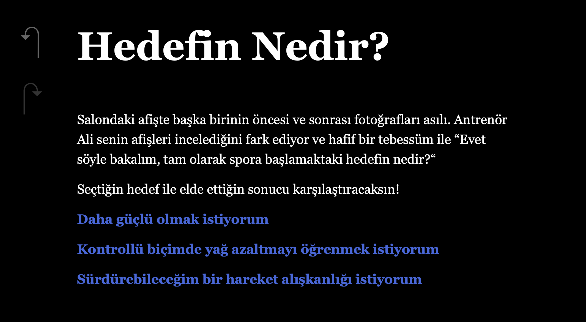

# Kendi Ritmin - Altı Haftalık Bir Başlangıç

[Français](README.md) | [Türkçe](README_TR.md)

## 1. Tanıtım ve özellikler

**Kendi Ritmin**, altı haftalık antrenman, beslenme ve toparlanma sürecini konu alan Türkçe bir interaktif öyküdür. Oyun, Twine ve Harlowe öykü biçimi kullanılarak hazırlanmıştır.

Oyuncu bir hedef seçer; ardından antrenman yoğunluğu, beslenme, uyku ve dinlenme hakkında kararlar verir. Bu seçimler, oyun boyunca biriken göstergeleri değiştirir. Göstergeler haftalık sonuçların ve oyun sonunun belirlenmesinde kullanılır.

- 60 pasaj ve altı farklı son.
- Hedef seçimi; kas gelişimi, yağ değişimi, yorgunluk, risk ve bilgi değerlerinin takibi.
- Her haftaya özgü olaylar ve mola kararının yönetimi.
- Son pasajlarda oyuna baştan başlama seçeneği.

Değerler oyuna özgü kurmaca göstergelerdir; gerçek fiziksel değişimleri tahmin etmezler.

## 2. Oyun ekran görüntüsü

## 3. Kurulum ve çalıştırma

### Çevrim içi oynamak

[Oyunu tarayıcıda aç](https://alicanylmzr.github.io/kendi-ritmin/)

### Bilgisayarda oynamak

1. **Code > Download ZIP** ile depoyu indirin.
2. Sıkıştırılmış dosyayı açın.
3. **index.html** dosyasını bir web tarayıcısında açın.

Oyunu oynamak için ayrıca bir yazılım veya paket kurmak gerekmez. Belgesel kaynaklara yönlendiren bağlantıları açmak için internet bağlantısı gerekir.

### Pasajları ve kodları incelemek

[Twine](https://twinery.org/2/) içinde **Library > Import** seçeneğini kullanıp **index.html** dosyasını seçin. İçe aktarma işlemi, pasaj haritasını açarak pasajların içeriğini düzenleyicide incelemenizi sağlar.

## 4. Kullanılan teknolojiler ve bileşenler

- **Twine 2.12.1:** dışa aktarılan dosyada belirtilen sürüm.
- **Harlowe 3.3.9:** HTML dosyasına dahil edilmiş öykü motoru.
- Değişkenler, seçimler, koşullar, hesaplamalar ve pasaj geçişleri için Harlowe makroları.
- Kaynak bağlantıları ve oyundaki göstergeler için HTML etiketleri.

**index.html** dosyası öyküyü, pasajları ve çalışması için gerekli motoru içerir. Sunucu, veri tabanı veya ek bir kütüphane indirmek gerekmez. Bu sürümde özel JavaScript ve CSS alanları boştur.

## 5. Kaynaklar, kullanılan belgeler ve katkılar

Senaryo ve öykü metinleri Alican Yılmazer’e aittir. Twine/Harlowe tarafından dahil edilen bileşenlerin lisans bilgileri ve katkı bildirimleri dışa aktarılan dosyada korunmuştur. Projenin metinleri için depoya ek bir lisans konulmamıştır.

### Araçlar ve belgeler

- [Twine](https://twinery.org/) ve [düzenleyici belgeleri](https://twinery.org/reference/en/).
- [Harlowe kullanım kılavuzu ve makro listesi](https://twine2.neocities.org/).
- Twine ve Harlowe’u öğrenmek için yararlanılan YouTube videoları; videolar bu README’de tek tek listelenmemiştir.
- Bir dil modeli yardımıyla hazırlanan, Türkçe açıklamalı makro rehberi; bu belge hocaya ayrıca iletilecek teslim belgeleri arasındadır.

### Oyunun « Kaynaklar » pasajında yer alan başvurular

- [CDC - Yetişkinler için fiziksel aktivite rehberi](https://www.cdc.gov/physical-activity-basics/guidelines/adults.html).
- [NIDDK - Yetişkinler için sağlık önerileri](https://www.niddk.nih.gov/health-information/weight-management/healthy-eating-physical-activity-for-life/health-tips-for-adults).
- [NIH - Uykusuzluk](https://health.nih.gov/health-topics-a-z/insomnia).
- [NIAMS - Spor yaralanmaları](https://www.niams.nih.gov/health-topics/sports-injuries).
- [NIAMS - Spor yaralanmalarında tanı, tedavi ve izlenecek adımlar](https://www.niams.nih.gov/health-topics/sports-injuries/diagnosis-treatment-and-steps-to-take).

## 6. Büyük dil modellerinin kullanımı

### Kullanıldığı belirtilen araçlar

- **ChatGPT:** yazarın belirttiği sürüm **6.0**.
- **Euria:** tam sürüm bilgisi belirtilmemiştir.

### Bu proje için açıklanan başlıca kullanım alanları

- Bir başvuru rehberi oluşturmak amacıyla, düşünülen oyun özelliklerine uygun makro ve kodları Türkçe açıklamalarıyla listelemek.
- Twine’ın kullanımını, Harlowe makrolarını ve bunların uygulanmasını öğrenmek.
- HTML bağlantılarının oluşturulmasını, özellikle `<a>` etiketini ve `href` kavramını anlamak.
- Oyundaki göstergeleri `
` yapısında bir araya getirmek.
- Haftalık sonuçlar ve final koşulları için yapay zekâyı bir hesap makinesi gibi kullanarak matematiksel destek almak.
- Mola sisteminin oyun akışına bağlanması konusunda yardım almak.
- Hesap bloklarının çevresindeki boşlukları ve satır sonlarını sıkıştırmak için süslü parantezlerin `{ }` kullanımını anlamak ve uygulamak.
- Bu teslim açıklamasını ve yapay zekâ kullanım beyanının Fransızca çevirisini hazırlamak; teslim sürümünün ilk hafta planında koşul bloğunun parantez sınırını düzeltmek.

Farklı sonların nasıl olacağı ve hangi ilerleyişin hangi sona ulaşacağı projenin yazarı tarafından belirlenmiştir. Ayrıntılı kullanım beyanı ve makro rehberi hocaya iletilmek üzere hazırlanmıştır; bu herkese açık depoda yer almazlar.

### Başlıca istekler

Aşağıdaki ifadeler, çalışma sırasında anlatılan temel isteklerin yeniden ifade edilmiş hâlidir. Eski konuşmaların tamamının kelimesi kelimesine dökümü değildir.

1. Oyunun antrenman, beslenme, dinlenme ve mola seçimlerini açıklayıp gerekli makro ve kodların Türkçe açıklamalarıyla listelenmesini istemek.
2. Pasajlardaki makroların ve işaretlerin anlamını, ayrıca Twine’ın nasıl kullanılacağını sormak.
3. `<a href="…">` ile tıklanabilir kaynak bağlantısı oluşturmayı ve `
` ile değerleri bir kutuda göstermeyi sormak.
4. Seçimlerin haftalık sonuçlara ve farklı sonların koşullarına etkisini hesaplamak için matematiksel destek istemek.
5. Mola kararının ve bu kararın sonraki seçimler üzerindeki etkilerinin düzenlenmesi için yardım istemek.
6. Hesapların çevresindeki boşluk ve satır sonlarından kaynaklanan metin kaymasını önlemenin yolunu sormak.
7. Yapay zekâ kullanım beyanının Fransızcaya çevrilip PDF olarak hazırlanmasını, ardından deponun ve açıklama dosyasının teslim yönergelerine göre hazırlanmasını istemek.

## 7. Geliştirme bağlamı

Bu proje, **Lozan Üniversitesi**nde **Isaac Pante** tarafından verilen **Fiction interactive** dersi kapsamında geliştirilmiştir (SLI, Edebiyat Fakültesi).

**Yazar: Alican Yılmazer.**
